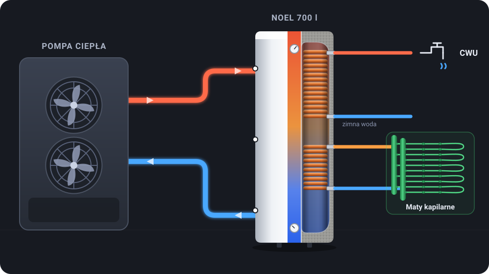

# Heiko Thermal → Home Assistant (odczyt i sterowanie lokalne)

Integracja Home Assistant do odczytu pompy ciepła **Heiko Thermal** przez fabryczny moduł Wi-Fi **USR-W600**. To ten sam moduł, który wysyła dane do portalu MyHeatPump. Działa w sieci lokalnej, bez chmury. Domyślnie **tylko słucha**. Po włączeniu `allow_write: true` może też włączać i wyłączać pompę oraz zmieniać tryb pracy. Wysyła wtedy dokładnie te same ramki co chmura MyHeatPump, podsłuchane 15.11.2026 (zobacz [Sterowanie](#12-sterowanie-lokalne)).

Odczyt sprawdzony na Heiko Thermal 9 (jednofazowa sprężarka plus 9 kW grzałek). Sterowanie i panel sprawdzone na Heiko Thermal 15 kW (dwa wentylatory), oprogramowanie 212. Pompy produkuje AMITIME, a te same urządzenia są sprzedawane także jako Neoheat. Inne modele z tej rodziny z modułem USR-W600 prawdopodobnie wysyłają te same ramki, ale pola trzeba zweryfikować (zobacz [Weryfikacja pól](#weryfikacja-pól)).

Co daje integracja:
- 32 opisane encje odświeżane co 30 s: temperatury wody i czynnika, ciśnienia, częstotliwość i prąd sprężarki, wentylatory, zawór rozprężny, odszranianie, pompy obiegowe, tryb pracy, temperatura zadana, liczniki czasu pracy grzałek;
- encję `sensor.heiko_ustawienia` z ramką ustawień (138 parametrów w atrybutach);
- log zmian nierozpoznanych flag (CSV), który pomaga je rozszyfrować;
- przykładowe alarmy, powiadomienie o pracy grzałek i gotowy panel;
- opcjonalnie: `select.heiko_tryb_pracy_pompy` (Ogrzewanie / Auto / CWU / Chłodzenie), `switch.heiko_pompa_wlaczona` i harmonogram trybu.

---

## 1. Jak to działa

```
Pompa ──RS-485 115200 8N1──> USR-W600 ──Socket B──> www.myheatpump.com:18899   (chmura, bez zmian)
                                 └──────Socket A──> TCP server :8899  <── Home Assistant (słucha)
```

Pompa **sama wypycha** ramki przez RS-485. Moduł przekazuje je przezroczyście na oba gniazda. Wystarczy połączyć się z portem 8899 modułu i czytać. Portal MyHeatPump i aplikacja działają dalej normalnie.

- Ramka **typ 1** (live): co ~10 s, 45 liczb.
- Ramka **typ 2** (ustawienia): co ~60 s, 138 liczb.

## 2. Przygotowanie modułu USR-W600

1. Znajdź IP modułu w routerze (klient o nazwie w stylu `USR-W600`/`WIFI` i MAC producenta USR IOT). **Zarezerwuj mu stały adres w DHCP.**
2. Otwórz `http://IP_MODUŁU`. Fabryczny login to **admin / admin**. **Od razu zmień hasło**, bo moduł jest w sieci lokalnej, a z fabrycznym hasłem każdy może go przekonfigurować.
3. Sprawdź ustawienia gniazda A. U nas było tak fabrycznie, nic nie zmienialiśmy:
   - Socket A: **TCP Server**, port **8899**, tryb przezroczysty (bez protokołu).
   - Socket B: TCP Client → `www.myheatpump.com:18899`. **Nie ruszaj**, bo to połączenie z chmurą.
   - UART: 115200, 8N1. **Nie zmieniaj.**
4. Test z dowolnego komputera w sieci: `python3 tools/heiko_sniff.py IP_MODUŁU`. Po ~10 s powinna się pojawić tabela 45 pól.

## 3. Instalacja w Home Assistant

**Ręcznie:** skopiuj katalog `custom_components/heiko_thermal` do `/config/custom_components/`.

**HACS:** HACS → menu ⋮ → *Własne repozytoria* → `https://github.com/stalowydom/ha-heiko`, kategoria *Integracja* → zainstaluj.

**Bez HACS: jedno polecenie w terminalu HA** (dodatek Studio Code Server albo SSH). Instaluje albo aktualizuje integrację, kopiuje pakiety (istniejące nadpisuje tylko z `UPDATE=1`, z kopią `.bak-heiko`), dopisuje konfigurację (z kopią `configuration.yaml.bak-heiko`), sprawdza ją i restartuje HA:

```bash
curl -sL https://raw.githubusercontent.com/stalowydom/ha-heiko/main/tools/install_ha.sh | HOST=192.168.1.183 NOTIFY=mobile_app_twoj_telefon bash
```
`HOST` to IP modułu USR-W600, `NOTIFY` to usługa powiadomień dla alarmów (opcjonalna). Przy aktualizacji wystarczy samo `curl … | bash`, a `UPDATE=1` podmienia też pakiety na nową wersję. `ENERGY`, `INDOOR` i `OUTDOOR` (encje licznika energii oraz temperatur wewnątrz i na zewnątrz) włączają dzienną statystykę kWh/K, opisaną w rozdziale 9.

Potem dodaj do `configuration.yaml`:

```yaml
heiko_thermal:
  host: 192.168.1.183   # IP modułu USR-W600 (stały adres!)
  # port: 8899          # domyślnie
  allow_write: true     # sterowanie trybem i włącznikiem; bez tego tylko odczyt
  # emulate_cloud: true # domyślnie: integracja potwierdza ramki pompy tak jak chmura
```

**Praca bez chmury.** Chmura MyHeatPump odpowiada na każdą ramkę pompy krótkim potwierdzeniem: `cmd 03` po ramce live i `cmd 04` po ramce ustawień. Gdy tych potwierdzeń brakuje, bo chmura padła albo została odłączona, pompa dalej wysyła dane, ale przestaje przyjmować zapisy. Dlatego integracja domyślnie wysyła te same potwierdzenia przez lokalne połączenie (`emulate_cloud: true`). Sterowanie z HA działa wtedy także bez chmury, a Socket B w module można wyłączyć.

Uwaga, w wersji 0.1 konfiguracja była pod `sensor: - platform: heiko_thermal`. Teraz jest osobna sekcja `heiko_thermal:`.

Uruchom ponownie HA. Encje mają nazwy `sensor.heiko_…`. Nierozpoznane pola są tworzone jako `sensor.heiko_pole_NN`. Część z nich jest domyślnie wyłączona. Włączysz je w *Ustawienia → Encje*.

Szczegóły działania:
- Integracja zapisuje stany co 30 s, choć ramki przychodzą co 10 s. To ogranicza rozrost bazy.
- Po 90 s bez ramek encje przechodzą w stan `unavailable`, a integracja sama łączy się ponownie, z rosnącą przerwą do 5 min.
- Konfiguracja jest w YAML (sekcja `heiko_thermal:`), bez kreatora w UI.

## 4. Format ramki

```
AA 55 | 01 | MAC (6 B) | 01 | długość u16 LE | typ u8 | 2 B | float32 LE × n | 2 B | 3A
```

- długość całej ramki = `długość + 15`;
- dane: liczby float32 little-endian od bajtu 15 do 3 bajtów przed końcem;
- typ: bajt 12 (1 = live, 2 = ustawienia);
- ramka kończy się bajtem `0x3A`.

Parser jest w [`protocol.py`](custom_components/heiko_thermal/protocol.py) i nie zależy od HA. Możesz go użyć w innym projekcie, np. Node-RED albo ESPHome.

## 5. Mapa pól ramki live (typ 1)

Pola ustalone przez porównanie z wyświetlaczem pompy i z portalem MyHeatPump w tej samej chwili.

| Pole | Encja / znaczenie | Jedn. | Uwagi |
|---:|---|---|---|
| 2 | `sensor.heiko_tryb_pracy`, tryb pracy | – | 0 = postój, 1 = CWU, 2 = ogrzewanie |
| 5 | Tuo, woda wyjście | °C | |
| 6 | Tui, woda wejście | °C | |
| 7 | Tup | °C | opisany jako „woda za skraplaczem”, ale zachowuje się jak temperatura rury czynnika (na postoju ~9–13 °C, przy starcie CWU spada blisko 0 °C), **do weryfikacji** |
| 8 | TW, zasobnik CWU | °C | |
| 9 | Tc, bufor | °C | |
| 10 / 11 | Tv1 / Tv2 | °C | u nas Tv1 = wyjście z bufora na podłogówkę, Tv2 = powrót z podłogówki |
| 12 | temperatura pokojowa | °C | z czujnika/panelu pompy |
| 13 | pompa obiegowa, sygnał | – | 0/100 na postoju, ~28–35 przy pracy sprężarki |
| 16 | pompa obiegowa, praca | 0/1 | na postoju ~1 min co ~6 min |
| 21 | sprężarka, częstotliwość | Hz | 0 = stoi |
| 22 | zawór rozprężny EEV, otwarcie | kroki | |
| 23 / 24 | Pd / Ps, ciśnienie tłoczenia / ssania | bar | |
| 25 | temperatura zewnętrzna | °C | |
| 26 | Td, tłoczenie | °C | |
| 27 | Ts, ssanie | °C | |
| 28 | Tp, parownik | °C | |
| 29 / 30 | wentylator 1 / 2 | rpm | |
| 31 | prąd sprężarki | A | |
| 32 | napięcie zasilania | V | |
| 33 | odszranianie | 0/1 | 1 tylko przy pracy sprężarki w mrozie |
| 34 / 35 | pompa P0 / P1 | 0/1 | |
| 36 | pompa P2 | 0/1 | u nas brak P2, pole niezmapowane |
| 37 | temperatura zadana bieżącego trybu | °C | przy CWU zadana CWU (np. 50), w pozostałych trybach zadana bufora/obiegu (np. 29); **to nie jest stała zadana CWU** |
| 38 | wersja oprogramowania | – | u nas 212 |
| 39 | prędkość sprężarki obliczona | – | |
| 40 / 41 | nieznane, zmienne | – | widoczne jako `pole_40/41`, zapisywane jako pomiar |
| 42 / 43 / 44 | czas pracy grzałek AH / HWTBH / HBH | min | liczniki rosnące; wzrost = grzałka pracowała |
| 0, 1, 3, 4, 14, 15, 17–20 | flagi 0/1, nieznane | – | zmiany trafiają do CSV (punkt 7); flagi 0, 1, 3, 4, 14, 15 co tydzień w piątek ok. 20:00 skaczą na chwilę do 10, pewnie cykl ochronny |

**Ramka ustawień (typ 2)** trafia do atrybutów `p000…p137` encji `sensor.heiko_ustawienia`. Nie jest zmapowana. Żeby rozpoznać parametr, zmień jedno ustawienie na pompie i sprawdź, który atrybut się zmienił.

## 6. Weryfikacja pól

Inny model albo inna wersja oprogramowania mogą mieć przesunięte pola. Sprawdzenie zajmuje ok. 10 minut:

1. `python3 tools/heiko_sniff.py IP_MODUŁU` pokazuje wszystkie 45 pól.
2. Wejdź jednocześnie na wyświetlacz pompy (menu parametrów / *Query*) albo na portal MyHeatPump. Porównaj kilka wyraźnych wartości, np. temperaturę zewnętrzną, TW, Hz i napięcie.
3. `--changes` pokazuje tylko zmieniające się pola. Tak najłatwiej znaleźć flagi (pompy, zawór, grzałki): uruchom coś na pompie i patrz, co się przełączyło.
4. Popraw indeksy w `LIVE_MAP` w [`sensor.py`](custom_components/heiko_thermal/sensor.py). `unique_id` to `heiko_thermal_<klucz>`, więc zmiana nazwy nie psuje historii.

## 7. Log nieznanych flag

Każda zmiana flag 0, 1, 3, 4, 14, 15, 17–20 jest dopisywana do `/config/heiko_flag_changes.csv`. Każdy wiersz ma kontekst: Hz, Tuo, Tui, TW, Tc, temperatura zewnętrzna, tryb, zadana, pola 40 i 41. Po kilku tygodniach widać, co się z czym przełącza. Tak rozpoznaliśmy tryb pracy (pole 2) i pompę obiegową (13/16).

Plik rośnie o ok. 450 wierszy dziennie. Usuń go albo wyłącz `UNKNOWN_FLAGS`, gdy przestanie być potrzebny.

## 8. Przykłady (`examples/`)

| Plik | Co robi |
|---|---|
| `packages/pompa_ciepla_alarmy.yaml` | skrypt `pompa_powiadom` (licznik alarmów, powiadomienie w HA i na telefony), sensory pomocnicze (sprężarka pracuje, odszranianie, tryb opisowo, starty/h, odszraniania dziś) i alarmy: brak danych 10 min, podejrzany Tuo (poza 1–65 °C albo skok >10 K, wczesne wykrycie usterki czujnika), CWU >3 h, taktowanie >5 startów/h |
| `packages/pompa_ciepla_harmonogram.yaml` | harmonogram trybu: Ogrzewanie nocą, Auto wieczorem; godziny w UI; wymaga `allow_write: true` (punkt 12) |
| `automations_grzalka.yaml` | powiadomienie, gdy którakolwiek grzałka zaczyna pracować |
| `dashboard/pompa_ciepla_panel.yaml` | **panel ogólny**: schemat (pompa, zawór trójdrogowy, zasobnik CWU, obieg grzewczy) z odczytami na żywo, sterowanie i harmonogram, wykresy temperatur, liczniki dnia, obieg chłodniczy; **tylko encje integracji i pakietów, tylko wbudowane karty HA** |
| `dashboard/schemat.svg` | źródło grafiki panelu ogólnego (w panelu jest osadzona; po zmianie uruchom `python3 tools/build_panel.py`) |
| `dashboard/pompa_ciepla_dashboard.json` | starszy panel (wymaga Mushroom i mini-graph-card z HACS) |
| `moja_instalacja/` | **przykład rozbudowanej instalacji** (bufor NOEL 700 l z trzema czujnikami, maty kapilarne, watomierz, sensory SQL); wymaga podmiany encji, opis w [README](examples/moja_instalacja/README.md) |



**Panel ogólny** (`dashboard/pompa_ciepla_panel.yaml`): Ustawienia → Panele → Dodaj panel → Nowy panel od zera → otwórz go → ⋮ → Edytuj → ⋮ → Edytor konfiguracji surowej → wklej całość. Instalator zapisuje gotową wersję w `/config/heiko_panel.yaml`. Panel ma trzy opcjonalne dodatki, oznaczone w pliku blokami `# >>> NAZWA` … `# <<< NAZWA`:
- `ENERGY`: wykres dziennego zużycia z licznika energii pompy (kWh);
- `POWER`: wskaźnik i wykres mocy pobieranej przez pompę (W);
- `INDOOR`: temperatura wewnątrz na schemacie.

Instalator wstawia w nie encje z parametrów `ENERGY=`, `POWER=` i `INDOOR=`, a bloki bez podanej encji usuwa. Przy ręcznym wklejaniu podmień `__ENERGY__`, `__POWER__` i `__INDOOR__` na swoje encje albo usuń te bloki. Karta sterowania i harmonogramu wymaga `allow_write: true` i pakietu harmonogramu; bez nich jej encje będą niedostępne.

Pakiety włączysz w `configuration.yaml`:

```yaml
homeassistant:
  packages: !include_dir_named packages
```

Skopiuj plik do `/config/packages/` i **zamień `notify.mobile_app_TELEFON_1/2` na własne usługi powiadomień**.

**Starszy panel** (`pompa_ciepla_dashboard.json`) ma kartę „Sterowanie (lokalnie)”. Bez `allow_write` i pakietu harmonogramu jej encje będą niedostępne, więc możesz ją usunąć. Panel wymaga z HACS kart **Mushroom** i **mini-graph-card**. Utwórz nowy panel → ⋮ → *Edytuj* → ⋮ → *Edytor konfiguracji surowej* → wklej zawartość pliku. JSON jest poprawnym YAML-em. Panel korzysta też z dwóch encji spoza integracji, które trzeba podmienić albo usunąć:
- `sensor.pompa_ciepla_moc`: moc pobierana przez pompę (W);
- `sensor.pompa_ciepla_energia`: energia pobrana przez pompę (kWh, licznik rosnący).

## 9. Pomiar zużycia prądu

Moduł nie podaje mocy elektrycznej. Do zużycia potrzebny jest osobny licznik na zasilaniu pompy, np. 3-fazowy licznik DIN z Zigbee (Tuya SPM01 i podobne) albo Shelly 3EM. Z tego, co nam się przydarzyło:

- **Przekładnik na złej fazie:** gdy P/(U·I) ≈ 0,5 zamiast ~1 przy pracującej sprężarce, cewka prądowa jest na innej fazie niż napięcie. Licznik zaniża wtedy zużycie o ~45%.
- **Odwrócony przekładnik:** zużycie trafia do licznika energii oddanej (`produced_energy`), a pobrana stoi w miejscu. Można przełożyć przewód. Można też w HA zsumować obie wartości szablonem, z wartością początkową oddanej w momencie odwrócenia:
  ```yaml
  template:
    - sensor:
        - name: Pompa ciepła energia
          unique_id: pompa_ciepla_energia
          unit_of_measurement: kWh
          device_class: energy
          state_class: total_increasing
          state: >-
            {{ (states('sensor.LICZNIK_energy') | float(0)
                + [states('sensor.LICZNIK_produced_energy') | float(0) - WARTOSC_W_DNIU_ODWROCENIA, 0] | max) | round(3) }}
  ```
- Heiko 9 ma **jednofazową sprężarkę**, więc pobiera prąd głównie z jednej fazy. Pozostałe fazy zasilają tylko grzałki (9 kW) i powinny pokazywać ~0, chyba że pompa przejdzie w tryb awaryjny.
- Do panelu *Energia* dodaj licznik jako urządzenie, wtedy widać udział pompy w zużyciu domu.

### Efektywność: kWh na stopień (kWh/K)

Samo dzienne zużycie mocno zależy od pogody. Integracja może co dobę liczyć **zużycie z danego dnia / (średnia temp. wewnątrz − średnia temp. na zewnątrz)**. Mniejsza wartość znaczy, że dom i pompa potrzebowały mniej prądu na każdy stopień różnicy. Dzięki temu można porównywać zimne i ciepłe dni, np. przed włączeniem harmonogramu i po nim. W zużyciu jest też CWU, więc przy bardzo małej różnicy temperatur wskaźnik lekko rośnie.

```yaml
heiko_thermal:
  host: 192.168.1.183
  efficiency:
    energy: sensor.pompa_ciepla_energia      # licznik kWh (total_increasing)
    indoor: sensor.salon_temperatura
    outdoor: sensor.temperatura_zewnetrzna
```

Wynik trafia do statystyki `heiko_thermal:kwh_na_stopien`, z datą tego samego dnia. Bieżący dzień się nie pojawia, bo jeszcze trwa. Po starcie integracja uzupełnia ostatnie 120 dni z historii HA, a potem dopisuje każdy dzień o 00:20. Wykres w panelu to `statistics-graph` z `period: day` i `stat_types: [mean]`.

## 10. Pułapki i wnioski z eksploatacji

- **Lokalizacja czujników zależy od instalatora.** Tuo i Tui mogą być przeniesione z jednostki zewnętrznej do wewnętrznej. Wtedy różnica Tuo–Tui nie jest różnicą temperatur na wymienniku. U nas Tui siedzi 5 m dalej na zasilaniu, więc różnica wynosi ~0,3 K zamiast ~3 K. Zanim zaczniesz liczyć moc grzewczą czy COP z tych czujników, sprawdź, gdzie fizycznie są.
- **Nie przenoś wszystkich czujników wody do domu.** Sterownik używa czujników w jednostce zewnętrznej do ochrony przed zamarznięciem wymiennika, kontroli odszraniania i zabezpieczenia przed przegrzaniem.
- **Tc (bufor) może mieć przesunięcie.** U nas pokazuje stale ~3,4 K więcej niż Tv1 na wyjściu z bufora, również przy stojącej sprężarce. Porównaj Tc z Tv1 i z Tuo, zanim zmienisz krzywą grzewczą na podstawie Tc.
- **Usterka czujnika Tuo (błąd F16)** powoduje przejście w tryb awaryjny i **włączenie grzałek 9 kW**. Zużycie rośnie wtedy wielokrotnie. Alarm „podejrzany Tuo” i powiadomienie o grzałkach wykrywają to od razu. U nas przyczyną był źle podłączony przewód czujnika.
- **Pole 37 to zadana bieżącego trybu**, nie stała zadana CWU.
- **Liczniki 42–44** to minuty pracy grzałek od zawsze. Do statystyk tygodniowych użyj `utility_meter` z cyklem `weekly`.
- **Taktowanie:** u nas przy ~0 °C sprężarka startuje ~8 razy na dobę i pracuje ~2 h na start, co jest w porządku. Więcej niż 5 startów na godzinę oznacza zbyt małą histerezę albo za wysoką krzywą.
- **Zużycie a temperatura:** po kilku tygodniach zrób regresję dobowego zużycia (kWh) względem średniej temperatury zewnętrznej. U nas wyszło ~30 kWh/dobę przy 0 °C (r = −0,97). Na tej podstawie łatwo ocenić efekt zmian krzywej czy temperatury w domu: −1 °C w pomieszczeniach daje ok. 5–6% mniej.

## 11. Bezpieczeństwo

- Bez `allow_write: true` integracja **nic nie wysyła** do modułu.
- Z `allow_write: true` wysyła tylko zapisy z białej listy w `const.py` (`WRITABLE`): p000 ∈ {0, 1} i p003 ∈ {1, 2, 3, 4}. Każda inna wartość jest odrzucana przed wysłaniem. Innych parametrów nie zapisuj, dopóki nie podsłuchasz ich ramki z chmury, bo błędny zapis może zmienić parametry pompy.
- Zmień fabryczne hasło `admin/admin` modułu USR-W600.
- Chmura (Socket B) działa nadal. Jeśli chcesz odciąć pompę od internetu, zablokuj modułowi wyjście w routerze, ale wtedy przestanie działać aplikacja.

## 12. Sterowanie lokalne

Ramki podsłuchane narzędziem `tools/heiko_cloud_proxy.py` (pośrednik między Socket B a chmurą) w czasie zmian w aplikacji MyHeatPump:

```
chmura -> pompa:  55 AA | 01 | MAC (6) | 01 | długość u16 LE | komenda | dane | CRC16 LE | 3A
CRC-16/MODBUS liczone od bajtu 2 (po 55 AA) do bajtu przed CRC
komenda 05, długość 7: zapis parametru ustawień -> indeks u16 LE + wartość float32 LE
```

| Akcja w aplikacji | Parametr | Wartość | Ramka (dla przykładowego MAC 0A1B2C3D4E5F) |
|---|---|---|---|
| Standby | p000 | 0.0 | `55 aa 01 0a 1b 2c 3d 4e 5f 01 07 00 05 00 00 00 00 00 00 78 15 3a` |
| Włącz | p000 | 1.0 | `55 aa 01 0a 1b 2c 3d 4e 5f 01 07 00 05 00 00 00 00 80 3f 59 c5 3a` |
| Heating | p003 | 1.0 | `55 aa 01 0a 1b 2c 3d 4e 5f 01 07 00 05 03 00 00 00 80 3f 59 f6 3a` |
| Cooling | p003 | 2.0 | `55 aa 01 0a 1b 2c 3d 4e 5f 01 07 00 05 03 00 00 00 00 40 79 d6 3a` |
| Sanitary hot water | p003 | 3.0 | `55 aa 01 0a 1b 2c 3d 4e 5f 01 07 00 05 03 00 00 00 40 40 48 16 3a` |
| Auto (CO + CWU) | p003 | 4.0 | `55 aa 01 0a 1b 2c 3d 4e 5f 01 07 00 05 03 00 00 00 80 40 18 16 3a` |

Obserwacje:
- Pompa odpowiada na zapis dodatkową ramką ustawień po ~3 s. Integracja czeka na nią (do 15 s), sprawdza nową wartość, a w razie braku ponawia raz i zgłasza błąd.
- Tryb (p003) i włącznik (p000) to osobne parametry. Zmiana trybu w Standby nie włącza pompy.
- Portal WWW przy Standby wysyła pustą komendę `05` (bez parametru), więc pompa jej nie wykonuje. Aplikacja na Androidzie wysyła poprawny zapis p000 = 0. Obie wysyłają komendy podwójnie, co dla pompy nie ma znaczenia.
- Chmura po każdej ramce od pompy wysyła 16-bajtowe potwierdzenie (komenda 03 dla live, 04 dla ustawień). Pompa nie wymaga go na Socket A, bo działa też bez chmury.

**Harmonogram** (`examples/packages/pompa_ciepla_harmonogram.yaml`):
- Ogrzewanie od 00:00, Auto od 19:00. Godziny i włącznik harmonogramu ustawiasz w UI (Pomocnicy).
- **Ręczne Auto w godzinach Ogrzewania** (z HA albo z aplikacji) oznacza, że ktoś chce gorącej wody. HA czeka, aż pompa skończy grzać CWU (pole 2 przestaje być 1 przez 2 min), i dopiero wtedy wraca na Ogrzewanie. Jeśli CWU nie ruszy w 15 min, bo woda jest już ciepła, wraca od razu. Maksymalnie czeka 4 h.
- O północy, jeśli pompa akurat grzeje CWU, najpierw dokończy.
- Nie rusza ręcznie ustawionego Chłodzenia ani samej CWU. Po restarcie HA ustawia tryb właściwy dla bieżącej godziny. Jeśli zmiana się nie uda, tworzy powiadomienie.
- `sensor.heiko_harmonogram_status` pokazuje, na co harmonogram czeka.

**Po podsłuchu** przywróć w USR-W600 Socket B na `www.myheatpump.com` (port 18899) i zatrzymaj pośrednika. Sterowanie z HA idzie przez Socket A i pośrednik nie jest do tego potrzebny.

## Struktura repozytorium

```
custom_components/heiko_thermal/   integracja (local_push)
  protocol.py                      parser ramek i budowa komend (CRC16/MODBUS), bez zależności od HA
  listener.py                      połączenie z modułem, zapis z potwierdzeniem
  const.py                         parametry i biała lista zapisów
  sensor.py                        mapa pól (LIVE_MAP), encje odczytu
  select.py / switch.py            tryb pracy i włącznik (tylko z allow_write)
tests/test_protocol.py             ramki z chmury muszą się zbudować bajt w bajt
examples/packages/                 alarmy, harmonogram trybu
examples/dashboard/                panel ogólny + schemat.svg
examples/moja_instalacja/          przykład rozbudowanej instalacji (NOEL, maty kapilarne)
tools/heiko_sniff.py               podgląd ramek z konsoli (tylko odczyt)
tools/heiko_cloud_proxy.py         pośrednik moduł <-> chmura, loguje komendy z aplikacji (do rozpracowania zapisu)
tools/install_ha.sh                instalator / aktualizacja w HA
tools/build_panel.py               buduje panel ogólny z tools/panel_szablon.yaml i schemat.svg
```

## Zmiany względem pierwszej wersji

- Encja trybu pracy nazywa się `sensor.heiko_tryb_pracy` (tak ją tworzy integracja). Alarmy i panel odwoływały się do nieistniejącej `sensor.heiko_tryb_cwu`, więc alarm CWU >3 h, opis trybu i wykres CWU nie działały na świeżej instalacji.
- Pola dyskretne (tryb, flagi, pompy, odszranianie, wersja) mają stan całkowity: `1` zamiast `1.0`. Porównania w YAML używają `'1'`.
- Watchdog jest zatrzymywany przy zamykaniu HA.
- Encje nie pokazują się jako dostępne przed pierwszą ramką.
- `sensor.heiko_ustawienia` przechodzi w `unavailable`, gdy ramka ustawień nie przyszła od 4,5 min.

Podziękowania: pierwszą wersję odczytu (mapę pól, parser, alarmy i panel) przygotował użytkownik z grupy o pompach ciepła na Facebooku. Sterowanie, harmonogram i nowy panel dodano później.

Brak gwarancji: projekt powstał przez obserwację ramek, bez dokumentacji producenta. Sterowanie testowane na Heiko Thermal 9, oprogramowanie 212. Nazwy Heiko, AMITIME, USR IOT i MyHeatPump należą do ich właścicieli.
