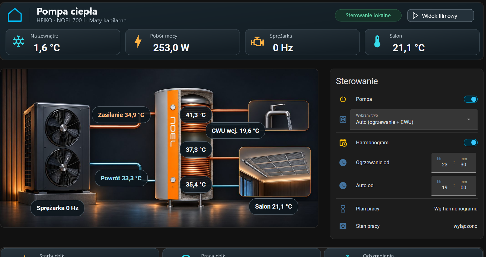

# Przykład: rozbudowana instalacja (Heiko 15 kW + bufor NOEL 700 l + maty kapilarne)

Ten folder pokazuje panel z konkretnego domu: pompa Heiko Thermal 15 kW (dwa wentylatory), bufor higieniczny NOEL 700 l z dwiema wężownicami i sufit chłodząco-grzewczy z mat kapilarnych. **Nie zadziała u Ciebie bez zmian**, bo korzysta z czujników spoza integracji. Potraktuj go jako inspirację albo punkt wyjścia.

Dla typowej instalacji użyj panelu ogólnego: [`examples/dashboard/pompa_ciepla_panel.yaml`](../dashboard/pompa_ciepla_panel.yaml).

| Plik | Co to jest |
|---|---|
| `pompa_ciepla_panel.yaml` | panel ze schematem tej instalacji (bufor z 3 czujnikami, CWU, maty), sterowaniem, wykresami i zużyciem energii |
| `schemat.svg` | źródło grafiki schematu (w panelu jest osadzona) |
| `podglad.png` | podgląd panelu |
| `panel_gpt.png` | wariant panelu z grafiką fotorealistyczną |
| `sql_sensory.md` | sensory SQL i pomocnicze: zużycie w miesiącu, średnia dzienna, wczoraj, starty CO/CWU |

## Encje spoza integracji

Podmień je na swoje (najprościej „znajdź i zamień” w pliku panelu) albo usuń karty, które ich używają.

| Encja w panelu | Co mierzy | Czym zastąpić |
|---|---|---|
| `sensor.temperatura_gorna_noel_sonoff_snzb_02ld` | bufor – góra | czujnik w górnej części zasobnika |
| `sensor.temperatura_srodek_noel_sonoff_snzb_02ld` | bufor – środek | czujnik w środku zasobnika |
| `sensor.temperatura_dol_noel_sonoff_snzb_02ld` | bufor – dół | czujnik w dolnej części zasobnika |
| `sensor.temperatura_cwu` | zasilanie z pompy (czujnik na rurze) | albo `sensor.heiko_tuo_woda_wyjscie` |
| `sensor.maszynownia_czujnik_temperatury_cyrkulacja_cwu` | woda wchodząca do CWU | dowolny czujnik albo usuń |
| `sensor.temperatura_zewnetrzna_finalna` | temperatura zewnętrzna | albo `sensor.heiko_temperatura_zewnetrzna` |
| `sensor.salonkuchnia_salon_temperatura` | temperatura w salonie | czujnik pokojowy |
| `sensor.tze284_dikb3dp6_ts0601_total_power` | moc pobierana przez pompę (W) | Twój watomierz |
| `sensor.tze284_dikb3dp6_ts0601_energia` | energia pobrana przez pompę (kWh) | Twój licznik energii |
| `sensor.pompa_ciepla_*`, `binary_sensor.pompa_ciepla_status` | zużycie, starty, praca | zobacz `sql_sensory.md` |

Wskazówka dla tego typu zasobnika: fabryczny czujnik pompy (Tw) siedzi mniej więcej w połowie wysokości. Gdy w ciągu dnia pompa pracuje tylko na CO, a z góry ubywa ciepłej wody, środek nadal pokazuje „ciepło” i pompa nie startuje na CWU. Pomaga mniejsza histereza CWU albo sterowanie z HA na podstawie górnego czujnika.
